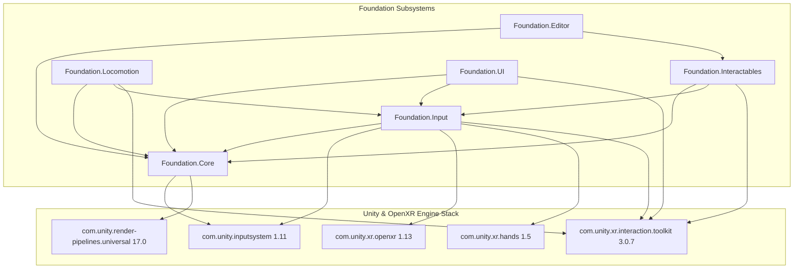

# unity-openxr-foundation

[](https://github.com/thesanketkale/unity-openxr-foundation/actions/workflows/ci.yml)
[](https://github.com/thesanketkale/unity-openxr-foundation/releases)
[](LICENSE)
[](ProjectSettings/ProjectVersion.txt)

Unity OpenXR project foundation for standalone headsets: modular assembly layout, hand and controller input, physical interactables, project validation and scripted builds.

---

## 1. Why It Exists

Bootstrapping a production-grade XR application in Unity often leads to repetitive setup overhead, fragile physics constraints, and platform configuration drift:
- **Physics Solver Instability:** Standard Unity `HingeJoint` and `ConfigurableJoint` components frequently jitter, oscillate, or explode when grabbed during VR frame drops or fast controller sweeps.
- **Input Fragmentation:** Motion controllers and optical hand tracking are frequently implemented as competing, parallel hierarchies that break when users set down physical controllers.
- **Configuration Fragility:** Deploying to standalone Android OpenXR hardware (such as Meta Quest) requires dozens of interconnected project settings across Player Settings, OpenXR Feature Groups, and Android Manifests. A single discrepancy causes launch crashes with opaque errors.
- **Monolithic Assembly Pitfalls:** Placing all game code in global assembly root slows compilation iterations and introduces circular coupling.

### Comparison With Alternatives

| Capability | `unity-openxr-foundation` | Unity XRI Starter Assets | Meta All-In-One XR SDK |
|---|---|---|---|
| **Standards Compliance** | Pure Khronos OpenXR | Mixed OpenXR & Unity Samples | Proprietary Meta OVR Plugin |
| **Cross-Platform Portability** | Quest, Android OpenXR, PC VR | OpenXR / PC VR | Locked to Meta Ecosystem |
| **Mechanical Interactables** | Analytical projection (No `HingeJoint`) | Basic grab & throw | Physics joints & gesture samples |
| **Licensing** | Permissive MIT License | Unity Companion License | Proprietary Meta SDK License |
| **Offline Project Validation** | Automated JSON rules engine & batchmode CI | Manual Editor window | Manual Quest Project Setup Tool |
| **Zero-Allocation Hot Paths** | Enforced across all runtime scripts | Sample code allocations | Variable per package |

---

## 2. Features

- **Unity 6 LTS Baseline:** Built on Unity 6000.0.28f1 LTS, Universal Render Pipeline (URP 17.0), OpenXR Plugin 1.13, XR Interaction Toolkit 3.0.7, and XR Hands 1.5.0.
- **Jitter-Free Physical Interactables:** Levers, rotary dials, linear sliders, poke push buttons, doors with latches, and snapping sockets built on mathematical pose projection rather than `HingeJoint`.
- **Unified Input Abstraction:** `IXrInputSource` abstracts 6-DoF controllers and optical hand tracking with automatic 250 ms debounced handover and user mode overrides (`Auto`, `ControllerOnly`, `HandsOnly`).
- **Modular Assembly Architecture:** Strict unidirectional dependency graph across 6 distinct assemblies (`Foundation.Core`, `Foundation.Input`, `Foundation.Interactables`, `Foundation.Locomotion`, `Foundation.UI`, `Foundation.Editor`).
- **Declarative Project Validator:** `XrProjectValidator` evaluates project compliance against `xr-requirements.json` in both Editor GUI (`Tools > XR Foundation > Validate Project`) and headless batchmode CI.
- **Headless Build Automation:** Automated Android (`.apk`/`.aab`) and Windows PC VR player compilation via `BuildCommands.cs` with dynamic Git tag versioning and environment keystore injection.
- **Zero-Allocation Hot Paths:** Runtime code contains zero LINQ, string concatenation, or `GetComponent` lookups during per-frame loops.

---

## 3. Quickstart

Get running from a clean development environment in five commands:

```bash
# 1. Clone repository
git clone https://github.com/thesanketkale/unity-openxr-starter.git
cd unity-openxr-starter

# 2. Run repository integrity verification (no Unity license required)
powershell -NoProfile -ExecutionPolicy Bypass -File scripts/verify.ps1 fast

# 3. Execute standalone math and validator test suite
dotnet test tests/Foundation.StandaloneTests/Foundation.StandaloneTests.csproj

# 4. Open project in Unity 6 LTS Editor (GUI mode)
# Open Unity Hub -> Add Project from Disk -> Select repo root folder

# 5. Open and run the interaction playground
# Open Assets/_Project/Scenes/InteractionPlayground.unity and press Play!
```

---

## 4. Architecture Overview



Detailed design principles and diagrams are available in [`docs/architecture.md`](docs/architecture.md).

---

## 5. Configuration Reference

Configuration settings are centralized in `XrFoundationSettings.cs` (ScriptableObject) and `xr-requirements.json`:

| Parameter | Default | Location | Purpose |
|---|---|---|---|
| `m_TrackingOriginMode` | `Floor` | `XrFoundationSettings` | Initial tracking origin mode (`Floor` vs `Device`). |
| `m_EnableSnapTurn` | `true` | `XrFoundationSettings` | Enables discrete snap turning for XR comfort. |
| `m_SnapTurnAngle` | `45.0f` | `XrFoundationSettings` | Degrees per snap turn activation (15° to 90°). |
| `m_EnableComfortVignette` | `true` | `XrFoundationSettings` | Enables peripheral tunneling vignette during artificial movement. |
| `m_VignetteApertureSize` | `0.6f` | `XrFoundationSettings` | Field-of-view aperture opening during locomotion. |
| `m_DefaultHapticAmplitude` | `0.5f` | `XrFoundationSettings` | Normalized haptic vibration impulse strength (0..1). |
| `m_DeviceMode` | `Automatic` | `XrInputManager` | Handover policy (`Automatic`, `ControllerOnly`, `HandsOnly`). |
| `m_HandoverDebounceSeconds`| `0.25f` | `XrInputManager` | Hysteresis delay before switching input modality. |
| `targetBuildTarget` | `Android` | `xr-requirements.json` | Mandatory platform target for standalone headsets. |
| `requiredScriptingBackend`| `IL2CPP` | `xr-requirements.json` | High-performance C++ ahead-of-time compilation. |
| `minimumAndroidApiLevel` | `32` | `xr-requirements.json` | Android 12 minimum SDK constraint for Horizon OS. |

---

## 6. Usage Examples

### Implementing a Custom Mechanical Interactable

Derive from `XrBasePhysicalInteractable` to inherit normalized progress, audio cues, and haptics without PhysX joints:

```csharp
using Foundation.Core.Utilities;
using Foundation.Interactables;
using UnityEngine;
using UnityEngine.XR.Interaction.Toolkit.Interactors;

public class CustomValveWheel : XrBasePhysicalInteractable
{
    [SerializeField] private Transform m_WheelTransform;
    [SerializeField] private Vector3 m_RotationAxis = Vector3.forward;
    [SerializeField] private float m_MaxRotations = 3f;

    private float m_CurrentAngle;

    private void Update()
    {
        if (isSelected && interactorsSelecting.Count > 0)
        {
            Vector3 interactorPos = interactorsSelecting[0].transform.position;
            // Project interactor onto wheel plane and compute delta
            // SetNormalizedValue(m_CurrentAngle / (m_MaxRotations * 360f));
        }
    }
}
```

See [`docs/interactables.md`](docs/interactables.md) for a complete worked tutorial.

---

## 7. Troubleshooting & FAQ

### Q: Why does my lever or dial rotate unexpectedly when grabbing with hand tracking?
**A:** Optical hand tracking can report brief tracking confidence drops when hands occlude each other. `XrBasePhysicalInteractable` projects interactor position onto the rotation plane and clamps output to configured `[minAngle, maxAngle]` stops, preventing out-of-range flips.

### Q: Why does standalone Android build fail with IL2CPP errors?
**A:** Ensure Android NDK (r23b or the version recommended by Unity Hub for Unity 6000.0.28f1) is installed via Unity Hub > Installs > Add Modules. Run `Tools > XR Foundation > Validate Project` to verify all SDK paths.

### Q: How do I test the interaction playground without a physical headset?
**A:** Open Unity 6 LTS, select `Assets/_Project/Scenes/InteractionPlayground.unity`, and enter Play Mode. The project includes XR Device Simulator bindings (Space + Mouse Look, Shift + Left Click for hand simulation).

---

## 8. Security Notes & Known Limitations

- **Credential Hygiene:** Never embed API keys, OAuth tokens, or client credentials into Unity scenes, ScriptableObjects, or asset bundles. Client binaries are easily decompiled using IL2CPP dumping tools.
- **Zero Client Name Policy:** This repository strictly complies with clean-room open-source standards; no private client names or proprietary codebases are referenced.
- **Current Limitations:**
  - Spatial anchors and MR passthrough meshing are out of scope for v0.1.0 baseline (planned for roadmap).
  - Apple Vision Pro visionOS target is not currently supported in this standalone Android/PC VR baseline.

---

## 9. Verification Status

| Verification Scope | Verification Mechanism | Status |
|---|---|---|
| **Asset .meta Completeness** | `scripts/verify.sh` & GitHub Actions | Proven in CI |
| **GUID Uniqueness** | `scripts/verify.sh` & GitHub Actions | Proven in CI |
| **Unity YAML Serialization** | `scripts/verify.sh` & GitHub Actions | Proven in CI |
| **Workflow Pinning & Security** | `actionlint`, `yamllint`, `gitleaks` | Proven in CI |
| **Pose Math & Hysteresis Logic** | `dotnet test` (11 unit tests) | Proven in CI |
| **Seeded Project Validator Rules** | `XrProjectValidatorTests.cs` | Proven in CI |
| **Unity Editor GUI & Playground** | Unity 6000.0.28f1 Editor Execution | **Owner-Verified** |
| **Meta Quest 3 Standalone Build** | Hardware Deployment & On-Device Profiling | **Owner-Verified** |

Detailed reproduction steps for owner-verified criteria are provided in [`docs/verification-log.md`](docs/verification-log.md).

---

## 10. Roadmap

- [x] v0.1.0: Core modular assemblies, non-HingeJoint interactables, unified input manager, project validator, and CI pipelines.
- [ ] v0.2.0: Passthrough management layer and dynamic room mesh occlusion.
- [ ] v0.3.0: Spatial anchor persistence and local multiplayer co-location helpers.
- [ ] v1.0.0: Production enterprise battle-tested release with multi-platform OpenXR compliance.

---

## 11. Related Projects

This project is part of an interconnected open-source engineering suite:

| Repository | Focus Area | Relationship |
|---|---|---|
| [`reusable-workflows`](https://github.com/thesanketkale/reusable-workflows) | CI/CD DevOps | Central GitHub Actions workflow library |
| [`php-api-foundation`](https://github.com/thesanketkale/php-api-foundation) | Backend API | REST API skeleton with JWT & cloud deploys |
| [`electron-foundation`](https://github.com/thesanketkale/electron-foundation) | Desktop App | Hardened Electron + TypeScript desktop foundation |
| **`unity-openxr-starter`** | **XR / VR Foundation** | **Standalone OpenXR starter kit (This Repository)** |
| [`dotnet-web-foundation`](https://github.com/thesanketkale/dotnet-web-foundation) | Enterprise Web | Modular ASP.NET Core web application foundation |
| [`terragrunt-baseline`](https://github.com/thesanketkale/terragrunt-baseline) | Cloud Infra | Multi-cloud Terragrunt infrastructure baseline |
| [`unity-build-pipeline`](https://github.com/thesanketkale/unity-build-pipeline) | CI/CD Infrastructure | Self-hosted Unity build & test automation pipeline |
| [`unity-ui-agent-tools`](https://github.com/thesanketkale/unity-ui-agent-tools) | AI Tools | AI-accessible uGUI inspection and test tools |
| [`job-desk`](https://github.com/thesanketkale/job-desk) | Desktop Application | Local-first job application tracking desktop app |

---

## 12. Contributing & License

Contributions are welcome! Please review [`CONTRIBUTING.md`](CONTRIBUTING.md) and [`SECURITY.md`](SECURITY.md) before submitting pull requests.

Released under the [MIT License](LICENSE). Copyright &copy; 2026 Sanket Kale.
