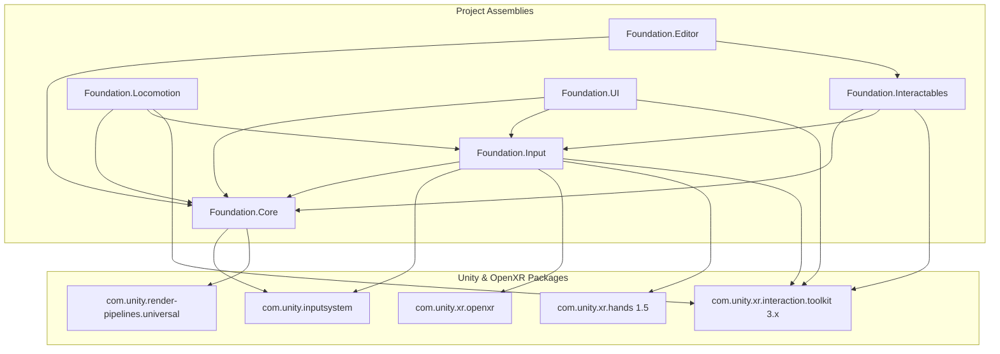
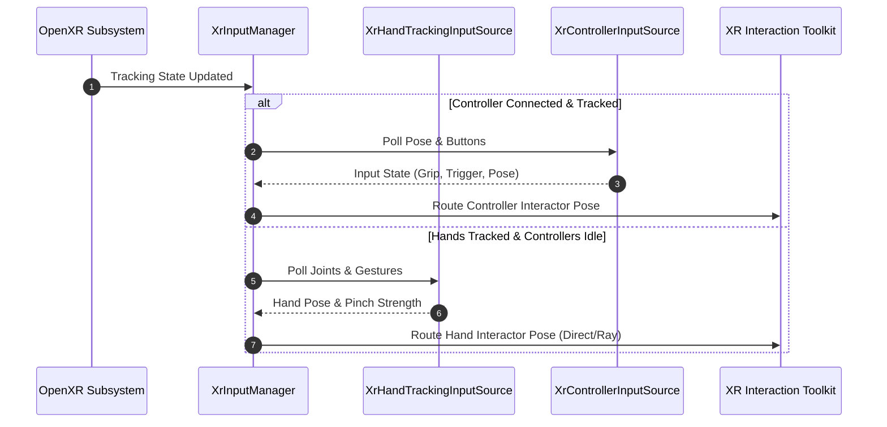
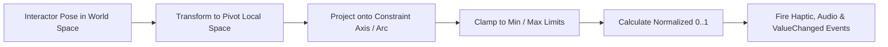

# System Architecture

## Overview

`unity-openxr-starter` provides a modular, production-ready foundation for standalone OpenXR applications targeting Android headsets (Meta Quest family and compatible OpenXR devices) and PC VR. It is architected for zero allocations in hot paths, deterministic physical interactables, and unified input handling across optical hand tracking and standard 6-DoF motion controllers.

## Assembly Boundary & Dependency Hierarchy

All runtime and editor code resides under `Assets/_Project/` organized into six distinct assemblies. Dependencies flow strictly downwards:

## Runtime Subsystems

### 1. Foundation.Core
- **Bootstrap Lifecycle:** `XrBootstrap` coordinates runtime initialisation, XR display subsystem startup, tracking origin modes (`Floor` vs `Device`), and tracking boundary events.
- **Service Locator:** `XrServiceLocator` provides a fast, type-keyed registry avoiding heap allocations and expensive `Object.FindAnyObjectByType` queries during runtime.
- **Pose Mathematics:** `PoseMath` provides pure, static, non-allocating vector and quaternion utilities for project-onto-plane, project-onto-axis, angular deltas, and hysteresis thresholds.

### 2. Foundation.Input
- **Strategy & State Machine:** Seamlessly integrates standard XR controllers with optical hand tracking through `IXrInputSource`.
- **Automatic Handover:** `XrInputManager` evaluates tracking state confidence and grip events. If a user sets down controllers to use hands, tracking automatically switches with a 250 ms debounce to prevent mode vibration.
- **Input Modes:** Supports `Auto` (dynamic switching), `ControllerOnly`, and `HandsOnly`.

### 3. Foundation.Interactables
- **Physics Calculation vs HingeJoint:** All mechanical interactables (levers, dials, sliders, buttons, doors) derive from `XrBasePhysicalInteractable : XRBaseInteractable`. Rather than relying on Unity's `HingeJoint` or PhysX iterative solvers—which exhibit severe jitter and explosion under VR frame rate drops—rotational and linear positions are computed analytically by projecting the interactor's 3D pose onto the component's constraint axis.
- **Unified Event Contract:** Every physical interactable exposes:
  - `float Normalized`: Normalized progress between `0.0f` and `1.0f`.
  - `event Action<float> OnValueChanged`: Invoked only when the value changes beyond a configurable epsilon.
  - Audio and haptic feedback hooks triggered on activation thresholds.

### 4. Foundation.Locomotion
- Provides configurable teleportation rays, snap turn (15°, 30°, 45° intervals), continuous smooth locomotion, and dynamic tunneling vignettes to preserve user comfort and prevent vestibular disorientation.

### 5. Foundation.UI
- Manages world-space user interfaces. `XrWorldSpaceCanvas` automatically configures ray and poke colliders, Canvas Scalers, and event camera bindings. `XrBillboardLabel` maintains legibility at variable distances.

### 6. Foundation.Editor
- Provides offline project validation via `XrProjectValidator` and headless build pipelines via `BuildCommands`.
